# Null OS screenshots

ISO from build run 41112515633, screenshots 2026-10-30

### 01-boot-menu
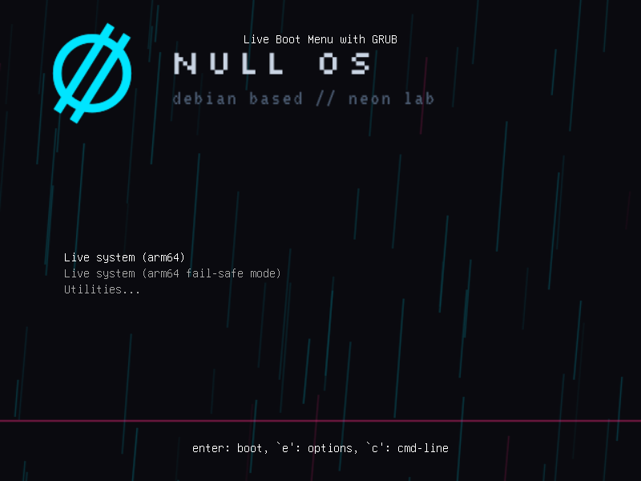

### 02-boot-00

### 02-boot-01
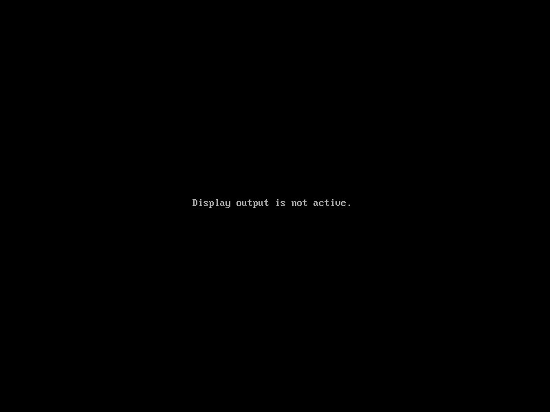

### 02-boot-02
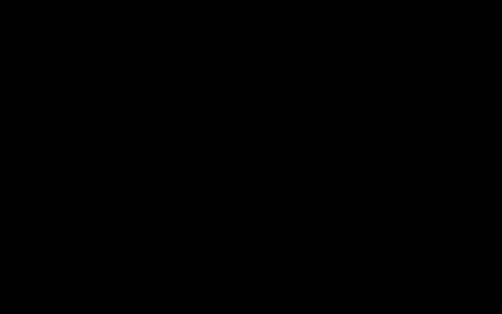

### 02-boot-03

### 02-boot-04

### 02-boot-05
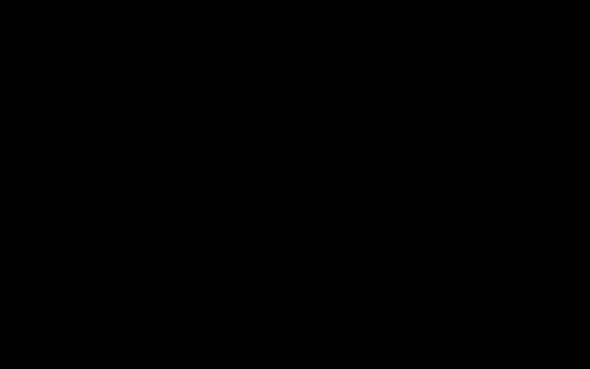

### 02-boot-06
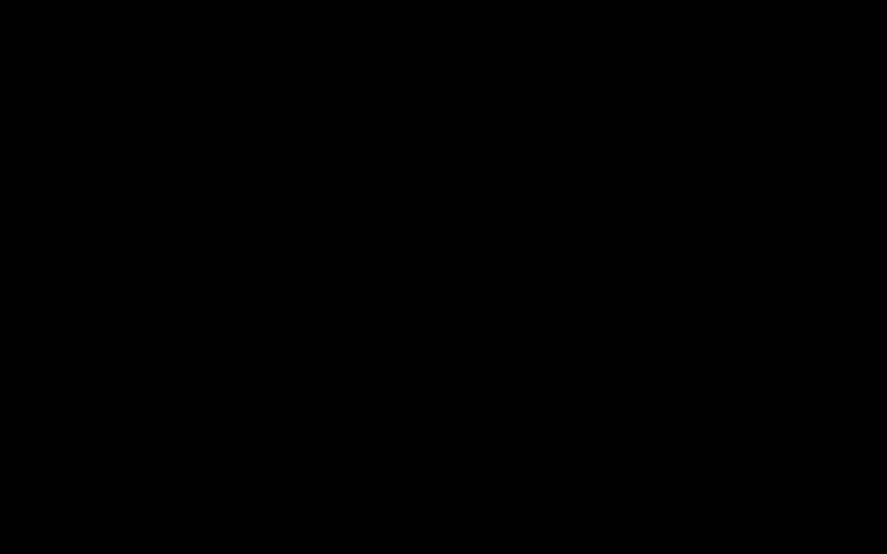

### 02-boot-07

### 02-boot-08

### 02-boot-09
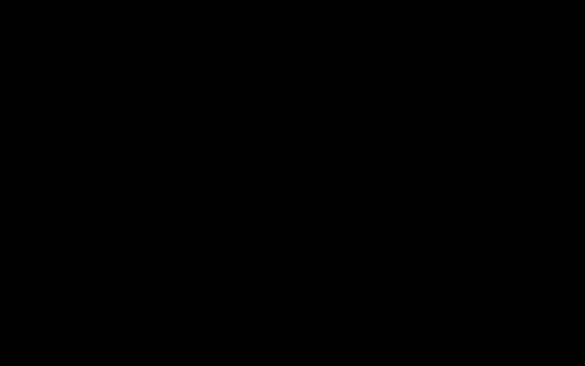

### 02-boot-10

### 02-boot-11
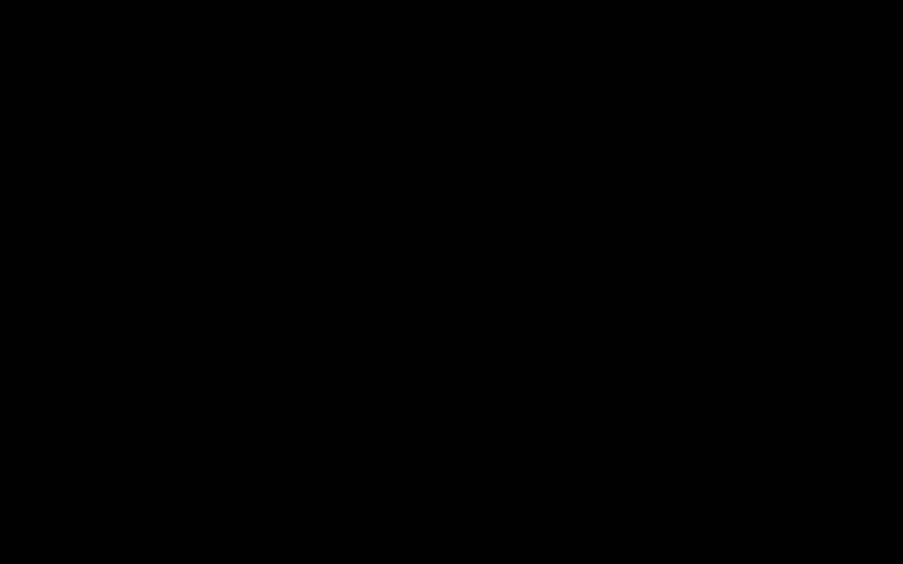

### 03-desktop
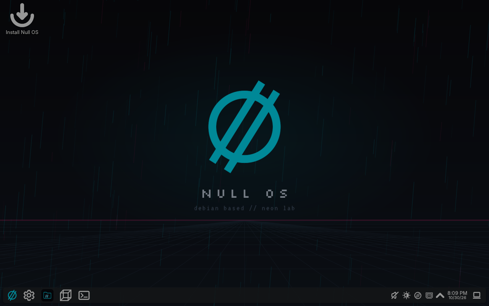

### 03b-desktop-again

### 04-start-menu

### 05-terminal
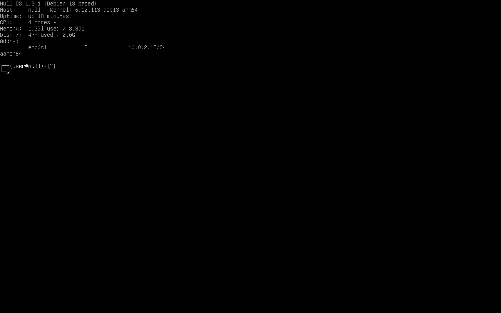

### 05b-fastfetch
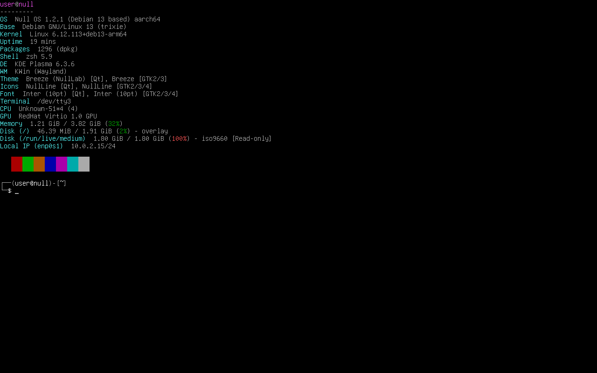

### 05g-extras-list
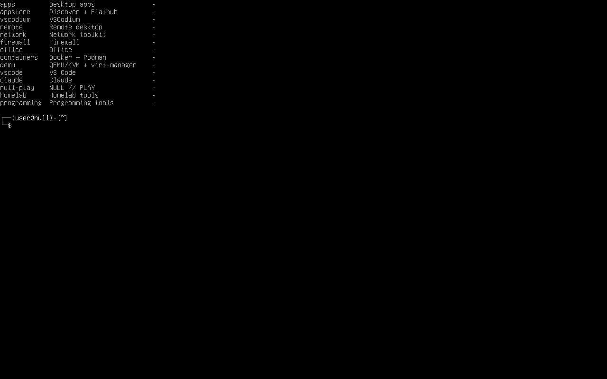

### 08-shutdown-00
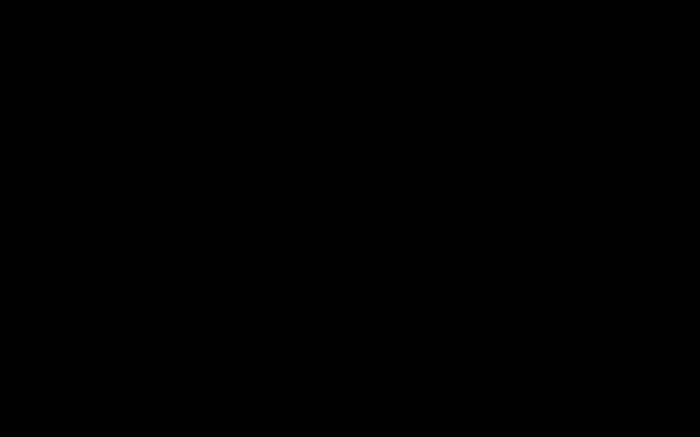

### 08-shutdown-01

